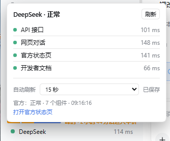

# dsh-deepseek-live-status

**中文** · [English](README.en.md)

DSH 插件。左侧栏底部一行：状态圆点 + `DeepSeek` + 最新平均延迟，点开是四项探针和官方状态。



## 它显示什么

**本机探针**（默认 60 秒一轮，只从本机发出）：`api.deepseek.com`、`chat.deepseek.com`、`api-docs.deepseek.com`、`status.deepseek.com`。记录 DNS 耗时、首字节延迟、HTTP 状态，最近 120 次采样用来算可达率和延迟走势。

**官方状态**：读 `status.deepseek.com` 的页面内嵌数据 —— 该站没有公开 JSON API。解析出 7 个组件与事件列表，按「是否有覆盖当前时刻的 impact」判定组件状态；解析不到就标未知。

## 安装

```sh
dsh plugin --profile web add github:m724523/dsh-deepseek-live-status
```

装完重启 `dsh web`。也支持 `#<commit>` 锁定版本，或 `./本地目录`。

## 自动刷新

卡片里可选 15 秒 / 30 秒（默认）/ 1 分钟 / 2 分钟，存在 `localStorage`，重开页面保留。到点会强制跑一轮探针，所以数据是即时的。15 秒是下限。

Host 不跑后台定时器：没有页面在刷的时候它不发任何请求，只保留最近一次结果。

## 配置

| 环境变量 | 默认 | 说明 |
| --- | --- | --- |
| `DSH_DEEPSEEK_STATUS_TIMEOUT_MS` | `9000` | 单次请求超时（1.5s–30s） |
| `DSH_DEEPSEEK_STATUS_URL` | `https://status.deepseek.com/` | 官方页地址，可换镜像 |

## 兼容性

`engines.dsh: ">=0.1.0-rc.5"`。缺服务时降级而不报错：没有 `shell.overlay` 就让挂件自己渲染卡片，没有 `locale` 就固定中文，没有来源校验接口就跳过校验。

## 已知限制

- 官方页的内嵌结构变了会解析失败，此时官方一栏降级为「页面可达、状态未识别」，本机探针照常
- 只统计本次运行期间的样本，重启清零
- 只测本机到这几个域名的连通性，不覆盖地区或账号级问题

## License

MIT
